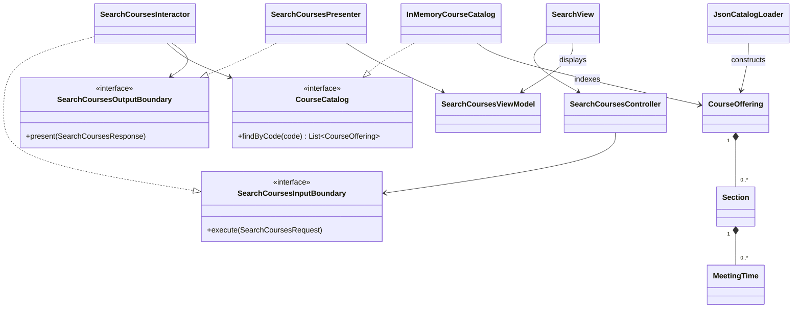

# Architecture plan

## First feature and acceptance criteria

As a student, I want to search by course code and see the matching offerings,
their sections, and their meeting times, so I can choose sections that fit my
schedule.

The initial flow is: enter a course code, search the catalogue, and display matching
offerings with their sections and meeting times.

- Ignore surrounding whitespace and capitalization when matching a full code.
- In the desktop view, suggest all distinct codes starting with the entered prefix,
  in alphabetical order. Choosing one performs the existing full-code search.
- Return every matching offering, labelled with its term and campus.
- Display each section's teaching type, known meeting times, and cancellation or
  TBA information. Preserve academic-session and recurrence details.
- Show a clear no-results message for an unknown code.
- Treat blank input as invalid and do not query the catalogue.
- Distinguish a catalogue failure from a successful search with no results.
- Do not interpret missing meeting times as proof of an asynchronous section or
  as proof that a section fits any schedule.

Timetable editing and automatic conflict detection are later features. This first
feature presents information so that students can assess their options themselves.

## Approach and dependencies

Use a small Clean Architecture design in Java. Keep domain objects and application
rules independent of storage formats and UI libraries. Interfaces belong to the
use case that needs them, and outer adapters implement those interfaces.

| Package | Components | Responsibility |
| --- | --- | --- |
| `domain` | `CourseOffering`, `Section`, `MeetingTime` | Represent catalogue concepts and basic validity rules |
| `usecase.searchcourses` | `SearchCoursesInteractor`, request/response data, boundaries, `CourseCatalog` | Validate and coordinate search |
| `usecase.suggestcoursecodes` | `SuggestCourseCodesInteractor`, boundaries, `CourseCodeIndex`, response | Normalize prefixes and coordinate autocomplete |
| `dataaccess.catalog` | `JsonCatalogLoader`, `InMemoryCourseCatalog` | Map JSON into domain objects and index offerings for lookup |
| `interfaceadapter.searchcourses` | Controller, presenter, view model | Translate UI actions into requests and responses into display state |
| `interfaceadapter.suggestcoursecodes` | Controller, presenter, view model | Translate typing events into requests and dropdown display state |
| `view` | Search view | Accept input and display results |
| `app` | `Main` | Load data, construct implementations, and connect dependencies |

Domain code depends on no outer layer. Use cases depend on domain objects. Data
and UI adapters depend on the relevant use-case contracts. Only startup wiring
needs to know all the concrete implementations.

`Main` injects a catalogue and output boundary into the interactor through its
constructor. The interactor does not construct a loader, presenter, or view.
Load and index the catalogue once at startup rather than parsing the full file
for every search. Report a startup load failure clearly instead of substituting
an apparently valid empty catalogue.

## Domain model

- `CourseOffering`: offering ID, code, title, campus, academic sessions, term
  designation, cancellation status, and sections. Use the offering ID for identity;
  a code alone is not unique.
- `Section`: identity within an offering, name, teaching type, cancellation/TBA
  status, meeting times, and linked-section references.
- `MeetingTime`: day, start/end time, academic session, optional location, and
  recurrence information.

Prefer immutable objects and read-only collections. Represent absent information
explicitly. Lectures, tutorials, and practicals are section types, not subclasses
of course offerings. Preserve recurrence and section-link information for later
scheduling features without implementing those features now.

The supplied snapshot contains multiple offerings for 1,028 course codes, sections
without meeting times, cancelled sections, and weekly, alternate-week, and manual
recurrence values. Confirm source encodings, including day numbering, before
mapping them into display labels; do not silently invent missing dates or times.

## Shared contracts

- `SearchCoursesRequest` contains the entered code. The interactor owns trimming,
  case normalization, and input validation.
- `CourseCatalog.findByCode` accepts a normalized full code and returns all matching
  offerings. An empty list means no matches; implementations never return `null`.
  If access fails, use a catalogue-specific failure defined at the use-case
  boundary, not a JSON-library or filesystem exception.
- `SearchCoursesResponse` distinguishes success, invalid input, and catalogue
  failure. Success may contain zero results. Response data is independent of UI
  widgets and JSON structures.
- The presenter owns display formatting and messages. The view receives display
  state rather than raw JSON or mutable domain objects.
- Search results have a documented, deterministic ordering. Specify the exact
  ordering and concrete data types together when writing the contracts. The initial
  implementation uses immutable Java records and orders offerings by sorted session
  codes, campus, term designation, then offering ID. Sections sort by name; meetings
  sort by session, weekday, start, end, recurrence, and location.

## Implemented class map

- `StatusFlag` represents yes, no, and unknown values. `LinkedSection` represents a
  section reference within an offering without recursively expanding that section.
- `OfferingResult` and its nested records copy data across the output boundary.
  `SearchCoursesResponse` explicitly distinguishes success, invalid input, and failure.
- `usecase.common.CatalogAccessException` is the shared use-case-owned failure
  contract for lookup adapters, so autocomplete does not depend on the search package.
  `CatalogLoadException` is a separate data-layer startup failure.
- `JsonCatalogLoader` streams a top-level JSON array one offering at a time, from
  a plain file, ZIP entry, or caller-owned reader. `JsonOfferingMapper` handles the
  external field names and conversions. Neither is used by the search interactor.
- `SearchCoursesViewModel` holds plain display text. `SearchView` renders it in Swing,
  while `ConsoleSearchView` supports terminal use and end-to-end fixture tests.
- `CourseCodeDropdown` handles Swing typing, arrow keys, scrolling, Escape, and
  selecting a code. It calls the suggestion controller, not the catalogue directly.
- `Main` loads data before starting Swing, then injects the in-memory catalogue and
  presenter into the interactor. Indexed searches run synchronously. Introducing a
  remote catalogue would also require background execution in the UI adapter so
  network latency does not block Swing's event thread.
- `SearchApplication.connect` is the UI-independent wiring point. It accepts the
  two catalogue ports and the two output boundaries and returns input boundaries.
  `Main` selects concrete implementations; the rest of the application does not.

## Replacing a module

To replace the visualizer, implement `SearchCoursesOutputBoundary` and
`SuggestCourseCodesOutputBoundary` with presenters for the new UI. Pass those
presenters to `SearchApplication.connect` and connect the returned input boundaries
to the new UI's input controls. The structured `OfferingResult` records contain
sections and typed times, so a graphical view never needs to parse the existing
text presenter. If only the window toolkit changes and text display is sufficient,
the existing presenters and view models can be reused directly.

To replace storage, implement `CourseCatalog` and/or `CourseCodeIndex` and inject
them through the same wiring method. They can be separate implementations. Keep
their normalization, no-match, sorted/distinct suggestion, and failure contracts.
No domain or interactor changes are needed for either substitution. `Main` is
intentionally the place where concrete launch choices change.

`SearchApplicationTest` verifies that an alternative renderer receives structured
results and that independent catalogue adapters produce the same search outcomes.
`ArchitectureTest` uses the JDK's dependency analyzer to enforce layer boundaries
on the compiled classes: no Swing/JSON imports in domain or use cases, no concrete
data/UI imports in presenters, and no direct catalogue access in views.

The adapter maps source day numbers using Monday=1 through Sunday=7, verified in
the [official timetable application's JavaScript](https://ttb.utoronto.ca/main.934e36b03104594f.js)
on November 21, 2026. `millisofday` is a wall-clock offset, not an epoch timestamp.
Session labels retain the raw code alongside the interpreted year/month. F/S/Y
designations are shown verbatim rather than assuming F always means fall.

Missing metadata stays unknown. Invalid required identity or meeting data fails
the load with a record/path diagnostic. The first implementation rejects overnight
meetings rather than silently losing the end day; the supplied snapshot contains
no such intervals. Weekly, alternate-week, and manual recurrence information is
retained, but actual dates and scheduling conflicts are not calculated yet.

## Autocomplete index and required ordering

`InMemoryCourseCatalog` implements two narrow ports: `CourseCatalog` for full-code
offering lookup and `CourseCodeIndex` for prefix suggestions. A separate suggestion
use case avoids adding autocomplete responsibilities to every exact-search adapter.
The shared catalogue-access exception represents failures for either lookup.

The catalogue constructs a hash map from normalized code to offerings, then builds
a sorted, distinct list from the map's keys. The supplied snapshot has 8,172
offerings and 7,094 distinct codes. Multiple terms for one code produce one
suggestion, while selecting that code still retrieves every matching offering.

**Required invariant: the prefix index must be sorted by natural Java String order,
using the same comparison as binary search, after normalization.** The constructor
sorts explicitly; it does not rely on JSON ordering, map iteration order, or the UI.
The list is immutable. When catalogue contents change, build a new complete index;
do not append codes to the old sorted list. Sorting with a different comparator
(for example a locale-specific display comparator) would invalidate this search.

With `n` distinct codes and `k` matches, sorting costs `O(n log n)` once at load
time, with `O(n)` extra index space. Each prefix query finds its lower bound using
binary search, then walks the contiguous matching range, for `O(log n + k)` time
and `O(k)` result space. A fresh unsorted scan costs `O(n)` per keystroke and would
also need to sort its matches for alphabetical display. These bounds treat code
comparisons as constant cost because course codes are short. Showing all matches
necessarily takes at least `O(k)` work.

No persistent database is needed for this snapshot. The sorted in-memory index is
the guarantee; the external JSON may remain unsorted. Exact-code lookup retains
the hash map. Blank input clears autocomplete without scanning the catalogue.
The desktop dropdown displays eight rows at once and scrolls over the full result
set; it never truncates the matching list. The console retains exact-code search.

## SOLID rules in practice

| Principle | Application |
| --- | --- |
| Single responsibility | Loader parses, catalogue searches, interactor coordinates, presenter formats, and view renders. |
| Open/closed | An alternative catalogue implements `CourseCatalog` without requiring changes to the search interactor. |
| Liskov substitution | Real and fake catalogues obey the same matching, empty-result, and failure contracts. |
| Interface segregation | Search needs a narrow read interface; future timetable saving gets a separate interface. |
| Dependency inversion | The use case defines the abstractions; data and presentation implementations are injected. |

Create interfaces at meaningful boundaries. Do not add an interface for every
class or introduce inheritance without a concrete substitutability requirement.

## Working together and code readability

- Agree on shared method signatures and request/response types before dividing
  implementation work. Coordinate changes to these contracts with their consumers.
- Split work along domain, search, catalogue, and UI boundaries. Use feature
  branches and small pull requests; do not push directly to `main`.
- Use descriptive names, small focused methods, and a consistent package layout.
- Declare explicit variable types in production code and tests; do not use `var`.
  Prefer precise interface types such as `List<CourseOffering>` or `CourseCatalog`
  when the implementation can vary, rather than coupling callers to concrete classes.
- Add plain comments documenting each class's purpose and each method's role,
  inputs, outputs, and failure behaviour where relevant. Javadoc is not required
  yet. Explain non-obvious decisions and data assumptions rather than narrating
  every statement.
- Keep parsing details, filesystem paths, and UI-specific dependencies out of the
  domain and use-case packages.
- Explain the change and its validation in each pull request so teammates can
  understand and extend the implementation.

## Implementation order and validation

1. Establish the build setup, shared contracts, and small domain model.
2. Implement search using a fake catalogue and a capturing output boundary. Test
   normalization, blank input, multiple offerings, no matches, and access failure.
3. Implement JSON mapping and indexed lookup with small representative fixtures.
   Cover missing times, cancellation/TBA flags, recurrence, and linked sections.
4. Connect the controller, presenter, and minimal view through startup wiring.
5. Smoke-test the full search flow using the supplied catalogue.

Routine tests should use small fixtures rather than loading the entire 130 MB
catalogue. Add timetable selection and conflict detection as separate use cases
after the first search flow works.
