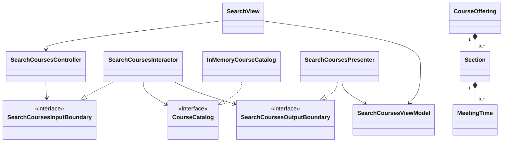
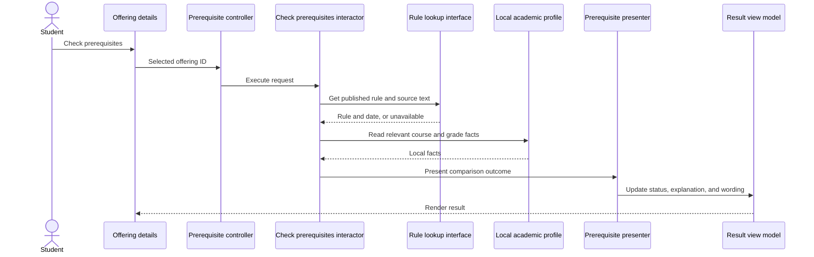

# Architecture

The current baseline is `main` at `07ecb4a`, which includes [PR #7](https://github.com/efeatalay9/207-course-project/pull/7). See the [project plan](project-plan.md) for product behaviour, the [implementation guide](implementation-guide.md) for the Java design and data, and the [course expectations](project-expectations.md#how-to-implement-a-use-case) for the use-case checklist.

## Dependency direction

The domain contains entities and their reusable rules. The use-case layer depends on the domain and owns the input, output, and data access interfaces it needs. The outer adapters implement those interfaces. Startup wiring can refer to concrete implementations to connect them.

| Package | Current responsibilities | Responsibilities as the plan grows |
| --- | --- | --- |
| `domain` | Offering, section, typed meeting time, linked-section reference, status flags, selected section, and in-memory timetable | Extend timetable state with locks and blocked time. Add the course plan and academic profile. Keep interval and section combination rules in ordinary Java. |
| `usecase` | Search, autocomplete, basic add, view timetable, and remove | Add the named interactors, boundaries, request/response data, and needed data access interfaces. Coordinate shared schedule checks. |
| `dataaccess` | JSON/ZIP loading and in-memory catalogue lookups | Decode public rules, timestamps, routes, and plan files. Implement network and persistence interfaces. |
| `interfaceadapter` | Controllers, presenters, and current view models | Convert input and prepare display state for the remaining actions. Display failures and uncertain results. |
| `view` | Swing search, code dropdown, and weekly grid, plus the console search view | Add search filters, details, course plan, profile and file actions. Own Swing components and their rendering. |
| `app` | Load the catalogue and connect the application | Construct shared timetable, catalogue, and other adapters. Pass dependencies to controllers, presenters, and interactors. |

The `ArchitectureTest` uses `jdeps` to check compiled package dependencies. It gives a regression check for dependency direction. Use-case tests and the runtime flow show whether the app also follows the course's interaction pattern. Keep Gson and Swing out of entities and use cases. [CSC207 Clean Architecture notes](https://github.com/CSC207-UofT/207-course-notes/blob/HEAD/11-clean-architecture.md)

The course's optional CAVE examples use names such as `entity`, `data_access`, `interface_adapter`, and `use_case`. The team's `domain`, `dataaccess`, `interfaceadapter`, and `usecase` packages group equivalent responsibilities. CAVE's auto-detection may need interpretation. The repo's compiled dependency test checks the actual package direction. Inspect both the source imports and interface ownership when reviewing changes. [Course tool guidance](quercus-project-guide.md#clean-architecture-checks-and-individual-reflection)

## Current working flows

### Search and autocomplete

`SearchApplication.connect` accepts the catalogue read interfaces and output boundaries, and returns the search and suggestion input boundaries. The console and Swing renderers can use the same exact-code flow. The interactor trims and normalizes the query, retrieves all matching offerings through `CourseCatalog`, orders them consistently, and creates structured output. A presenter formats the result and replaces the view model state for success, invalid input, and access failure. The view receives display data.

The catalogue implements two narrow ports. `CourseCatalog` retrieves offerings for a normalized full code. `CourseCodeIndex` provides sorted, distinct matching codes for a prefix. The full-code lookup returns an empty list for no matches and reports access failure via `CatalogAccessException`. `JsonCatalogLoader` streams the top-level array from a file or ZIP. `JsonOfferingMapper` owns source field names, validation, and date/time decoding.

The live API draft supplies an adapter for the same ports. It accepts a term and division as a `CatalogueScope` and keeps HTTP, JSON and caching in data access. The timetable continues using `OfferingLookup` to resolve selected offerings. The bundled ZIP remains an offline adapter. [Draft API PR #9](https://github.com/efeatalay9/207-course-project/pull/9)

**Prefix-index invariant.** Keep the immutable list of normalized distinct codes sorted by natural Java string order, the same order used by binary search. The initial build sorts the catalogue keys even if the JSON is shuffled. A query finds the lower bound and walks the matching range in **O(log n + k)** time for `n` distinct codes and `k` results. Eight rows are visible at once and the dropdown scrolls over the complete matching set. Rebuild the index when the catalogue changes.

### Weekly timetable and removal

`Main` passes one `Timetable` to add, remove, and view. The timetable owns ordered `SelectedSection` identities. `ViewTimetableInteractor` uses `OfferingLookup` to resolve those IDs into a session slice and well-typed meeting and status records. `ViewTimetablePresenter` turns them into `TimetableViewModel` state. `WeeklyTimetablePanel` and `WeeklyGrid` display it. `RemoveSectionInteractor` returns an outcome through its presenter, and the panel requests the updated view.

The current grid draws simultaneous display blocks in separate lanes. A recurrence-aware conflict decision belongs in the reusable schedule rules described below. The current weekly projection groups sections with no known meeting time under TBA. Extend the mapped source status so confirmed asynchronous meetings, TBA, arranged schedules, and cancelled sections have distinct outputs.

### Add Section

The local review build sends an `AddSectionRequest` with the offering ID and exact section name through `AddSectionInputBoundary`. The interactor uses the same `OfferingLookup` as the weekly grid to check that the offering and section exist and neither is confirmed cancelled. An existing section with a time to be announced can still be added. `Timetable` keeps one copy of a selection.

`AddSectionOutputBoundary` publishes one typed result. `AddSectionPresenter` writes the status for added, already selected, no selection, missing, cancelled, or catalogue unavailable. Swing refreshes the weekly grid from the same timetable and displays that status. Direct interactor tests check all outcomes and the separate Swing panel test verifies that the status survives a refresh. [Add Section tests](../src/test/java/usecase/addsection/AddSectionInteractorTest.java) · [Timetable panel test](../src/test/java/view/WeeklyTimetablePanelTest.java)

## Entities and shared contracts

| Object | Identity and values | Behaviour |
| --- | --- | --- |
| `CourseOffering` | Source offering ID, catalogue code, sessions, campus, title, sections | Resolve linked sections within this offering. Several offerings can have the same course code. |
| `Section` | Section identifier within its offering, teaching method, states, meetings, links | Keep required component and linkage facts when present. Report missing or contradictory facts through the use case. |
| `MeetingTime` | Academic session, weekday, local start/end, recurrence, and location | Preserve source times and recurrence. Compare confirmed occurrences as intervals. |
| `SelectedSection` and `Timetable` | Offering/section identities in insertion order. Proposed locks and personal blocks. | Add/remove selections, expose a defensive snapshot, and apply an accepted generated or repaired plan safely. |
| `CoursePlan` | Proposed basket of offering IDs and per-term preferences | Add/remove target courses and prepare generator input. |
| `AcademicProfile` | Proposed completed codes, optional grades, and supported facts | Provide the local facts used in published rule evaluation. |

Stable IDs and explicit uncertainty carry through the DTOs. Keep source day numbering Monday=1 through Sunday=7. Parse `millisofday` as a local time-of-day offset. Keep raw session codes where the app cannot reliably label them. For ordered search results, retain session, campus, term designation, and offering ID as ties. Meetings retain session, weekday, start, end, recurrence, and location. Keep a saved selection unresolved if it disappears.

### Shared scheduling logic

Put the smallest reusable rules in the domain and orchestration in the use-case layer. Use ordinary records and collections so fit, generation, conflict display, and repair can share them.

- Build the complete component combinations for an offering from published requirements and linkage. An unverified combo has an explicit data status.
- Check scheduled meetings and blocked intervals across dates or supported recurrence. A visual lane collision is decided by the grid for layout. A true conflict comes from the scheduling result.
- Reuse the checker for Find Courses That Fit, Generate a Timetable, Replace a Section That Filled Up, and the timetable conflict summary.
- Pass section combinations to the generator, keep the pure search testable, and evaluate ranking after hard rules. Give ranking and diversity a simple deterministic order.
- Keep travel estimation separate from scheduled time validity. Display the source and reason for unknown travel where needed.

### Proposed rule and plan adapters

The prerequisite file is a typed public rule tree. The HTTP adapter fetches a fixed URL and maps validated data to operations such as all, any, conditional, course, minimum grade, and earned credits. The interactor compares that tree against the local profile. Expose the original published requirement text with the decision. Use a cached valid rule set when a refresh fails. The separate Java prototype demonstrated this flow and reported limited conversion coverage. See [catalogue and external services](project-plan.md#catalogue-and-external-services) for the verified boundaries.

Use a use-case-owned interface for reading and saving plans, with a JSON file adapter. Check version and selected identities before replacing the active timetable. For explicit plan sharing, reuse a plan-only representation. Preserve local completed-course and grade data independently of the share format. Keep a shared timetable state in startup wiring so loading or applying a candidate updates all views that depend on it.

## Example sequence for the prerequisite check

For synchronous in-memory actions, the current views can render after the controller call. For HTTP refresh and generation, put long work on a Swing worker and keep view updates on the event dispatch thread. Capture the active plan before generation and validate the candidate against current state at apply time.

## SOLID and review examples

- **Single responsibility.** Catalogue parsing, search, presentation, and grid drawing are distinct. Extend the same separation to plan serialization and generation.
- **Dependency inversion.** `SearchCoursesInteractor` receives catalogue and output interfaces. `SearchApplicationTest` demonstrates interchangeable storage and output. Use the same approach for rules and local plans.
- **Interface segregation.** Code suggestions depend on `CourseCodeIndex`. The calendar lookup depends on `OfferingLookup`. Add methods to an interface when a real caller needs them.
- **Extensibility.** A new source can provide the same catalogue or rule data through its adapter. If comparing ranking strategies with distinct user preferences, use a small Strategy where it helps. Show the implemented class and motivation before presenting it as a design pattern.

For grading evidence, the [project pattern proposal](project-plan.md#design-choice-to-show-in-the-presentation) uses Memento for preserving a timetable before applying a generated plan or replacement. An immutable plan snapshot carries the old choices. The use case can keep it for the existing save/restore workflow while the active plan still owns validation and mutation. The [course expectation](project-expectations.md#design-pattern-expectation) explains the rubric distinction.

The next work follows the [integration order](project-plan.md#integration-and-verification-order). Use explicit Java types and plain names. When two views need the same refresh, let the presenter publish a simple view-model change and subscribe with Java's `PropertyChangeSupport`. With one view, an explicit Swing refresh can remain a simple implementation. In tests, inject a presenter recorder and assert its outcome after the interactor returns. [Course style and coverage expectations](project-expectations.md#style-and-checkstyle) · [Course architecture notes](course-notes-summary.md#specification-design-and-architecture)

## Section overlap warnings

`domain.MeetingOverlap` compares half-open meeting intervals in an academic
session and weekday. It distinguishes confirmed weekly clashes from possible
clashes whose recurrence is unverified. `usecase.overlaps.SectionOverlapChecker`
resolves section identities through `OfferingLookup`, compares every meeting
against a snapshot of current selections, and returns typed warnings. It does
not change the timetable or enforce linked-component validity.

The search warning interactor has input/output boundaries and a separate
controller/presenter. Its presenter decorates section choices with warning text.
The view-timetable interactor reuses the same checker; its presenter attaches
warnings only to the affected meeting blocks. Swing handles colours, labels,
and hover text. Warnings refresh after searches and selection changes, while
`AddSectionInteractor` continues to allow time conflicts. The current offering-ID
adapters read from memory; a future remote lookup must keep this work off Swing's
event thread.

### SOLID review of overlap warnings

| Principle | Current boundary and verification |
| --- | --- |
| Single responsibility | `MeetingOverlap` compares intervals; `SectionOverlapChecker` resolves and compares sections; interactors coordinate requests; presenters format warnings; Swing renders them. Addition remains a separate operation. |
| Open/closed | Search and timetable interactors accept `SectionOverlapCheck`. Another policy can be supplied at startup without editing those callers. New completeness checks should have their own result and presenter rather than extending the meaning of overlap warnings. |
| Liskov substitution | Checker implementations follow the same contract: one immutable result per candidate, no mutation of input selections, and `CatalogAccessException` for unavailable data. A substitute checker is tested through both callers. Uncertain data remains explicit rather than becoming a confirmed fit. |
| Interface segregation | The warning input/output boundaries, overlap policy, and offering lookup each expose only the operations their callers need. The warning checker does not require add/remove or Swing methods. |
| Dependency inversion | Use cases depend on lookup/output/policy interfaces; `Main` supplies concrete implementations. Domain and use cases do not import Swing, HTTP, or Gson. The compiled dependency test verifies these layer directions. |

These checks support the current feature's design; they do not prove all future
features are SOLID. Preserve the contracts when replacing adapters. Current
lookup adapters resolve offering IDs in memory. A remote implementation would
also require background execution at the UI boundary.

### Required components and view updates (planned)

A timetable can have no overlapping times while still lack a mandatory tutorial
or practical. Keep **time overlap** and **selection completeness** as separate
results, both visible at once. Do not treat the presence of a tutorial in the
catalogue as proof it is mandatory: the source's required-component and linkage
rules must establish that, and the current domain does not yet preserve every
such rule.

1. Add a separate selection-completeness use case that reads the selected offering
   IDs/section names and a verified component-requirement lookup. Coordinate its
   contract with the shared linked-bundle work led by Efe. It should return typed
   outcomes such as `COMPLETE`, `MISSING_REQUIRED_COMPONENT`,
   `INCOMPATIBLE_SELECTION`, and `NEEDS_REVIEW`, with the affected offering,
   component, and permitted linked choices. Do not put this logic in Swing or
   `MeetingOverlap`.
2. Give that result a separate presenter and view-model field. Keep overlap
   warnings intact rather than replacing them with completeness text. The view
   can show an amber badge beside a course group: **Tutorial required — choose
   one linked to LEC0101**. If a tutorial is selected without a required lecture,
   show the missing lecture. Show uncertain requirements as **Needs review**.
3. Trigger recomputation after adding, removing, changing a lecture, loading a
   plan, or refreshing relevant catalogue data. Publish a complete new display
   state so a resolved warning disappears. A shared selection-change event can
   replace the current callback as more views subscribe; keep it limited to
   actual consumers instead of introducing a general event framework.
4. Keep manual editing incremental: adding a lecture first may leave a visible
   missing-tutorial warning without preventing the addition. Full-bundle fit,
   generation, and replacement may require complete verified choices before
   labelling a result valid. Do not silently add another section.
5. Test a lecture missing its mandatory tutorial, a tutorial missing its lecture,
   an incompatible linked choice, a complete choice, an optional component, an
   unknown rule, and a removal that reintroduces a warning. Test that changing
   completeness status preserves any independent time-overlap warnings.

This is an implementation handoff, not a claim that mandatory-component badges
or a full Fits My Timetable feature are already present.
